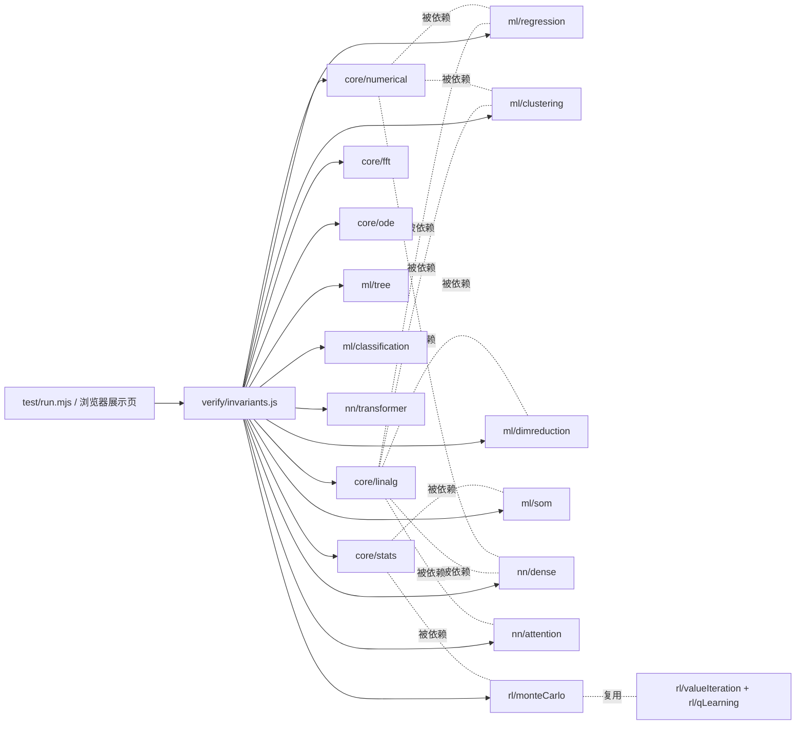

# 旗舰AI引擎 · 架构设计（ARCHITECTURE.md）

> 作者：晨星 (CJX0712) · 零依赖 · 浏览器 + Node 双跑 · 可验证不变量驱动

## 1. 实现方案与选型

| 决策点 | 选择 | 理由（站在谁之上） |
|---|---|---|
| 语言 | 纯 JavaScript ES Module | 浏览器/Node 原生双跑，零构建、零安装 |
| 依赖 | **0 个**（仅 Node 内置） | 数值算法全部手写但严格对齐权威实现 |
| 线性代数 | Jacobi 特征分解 / Householder QR / 部分主元高斯消元 | Golub & Van Loan《Matrix Computations》+ Numerical Recipes |
| 数值稳定 | logsumexp max-shift / 双支 sigmoid | 国际通行的数值稳定写法（scipy 同款思想） |
| EM / GMM | 对数域责任度 + Cholesky 行列式 | Bishop《PRML》第 9 章标准流程 |
| 注意力 | 缩放点积 + 多头 + 手推反向 | 《Attention Is All You Need》(Vaswani 2017) |
| 验证 | 每算法 ≥1 条可交叉验证的不变量 | forge 传统：解析解 vs 数值解、中心差分梯度检验 |

## 2. 文件清单

```
flagship-ai-engine/
├── src/
│   ├── index.js                 # 统一出口（barrel）
│   ├── core/
│   │   ├── linalg.js            # 线性代数：matmul/solve/inverse/cholesky/qr/jacobiEig/svd/powerIteration
│   │   ├── numerical.js         # 数值稳定：logsumexp/softmax/sigmoid/relu
│   │   ├── stats.js             # 概率统计：gaussianPDF/entropy/KL/covarianceMatrix/随机源
│   │   ├── fft.js               # 快速傅里叶变换（Cooley&Tukey'65 基-2 分治 FFT + 卷积定理）
│   │   └── ode.js               # 常微分方程数值积分（Euler/中点/RK4 + Dormand-Prince RK45 自适应）
│   ├── ml/
│   │   ├── regression.js        # 线性回归/岭回归/逻辑回归(+解析梯度)
│   │   ├── classification.js    # kNN / 高斯朴素贝叶斯
│   │   ├── clustering.js        # k-means(++初始化) / GMM(EM)
│   │   ├── dimreduction.js      # PCA(经 Jacobi 特征分解)
│   │   ├── dbscan.js            # DBSCAN 密度聚类（含 ARI 评估）
│   │   ├── tsne.js              # t-SNE 非线性嵌入（困惑度二分 + Student-t）
│   │   ├── kpca.js              # 核 PCA（特征空间中心化 + 核技巧，Schölkopf 1998）
│   │   ├── spectral.js          # 谱聚类 NJW（归一化拉普拉斯 + 谱嵌入）
│   │   ├── gpr.js               # 高斯过程回归（RBF 核 + Cholesky + 超参数梯度）
│   │   ├── gbdt.js              # GBDT 梯度提升树（回归树基学习器 + 负梯度）
│   │   ├── kalman.js            # 卡尔曼滤波（Joseph 更新 + DARE 稳态）
│   │   ├── mcmc.js              # Metropolis-Hastings + 重要性采样
│   │   ├── nmf.js               # NMF 非负矩阵分解（Lee-Seung 乘性更新）
│   │   ├── pagerank.js          # 网页排名(Page&Brin'98) 幂迭代/精确解/悬挂节点质量守恒
│   │   ├── gibbs.js             # 吉布斯采样(Geman&Geman'84) 二元高斯闭式条件/离散
│   │   ├── svm.js               # RBF 核 SVM（SMO 对偶求解，KKT 自检）
│   │   ├── boosting.js          # AdaBoost（决策树桩加权集成）
│   │   ├── hmm.js               # HMM 前向/后向 + Baum-Welch(EM)
│   │   ├── tree.js              # CART 决策树(Gini)
│   │   ├── gmm.js               # 高斯混合模型 GMM（EM 软聚类 + 协方差 PSD 正则）
│   │   ├── lda.js               # 线性判别分析 LDA/Fisher（闭式 Sw⁻¹(μ₁−μ₂)）
│   │   ├── naiveBayes.js        # 高斯朴素贝叶斯（对数域 + softmax）
│   │   ├── randomForest.js      # 随机森林（bootstrap + mtry 随机特征 + 多数投票）
│   │   ├── perceptron.js        # 感知机（误分驱动线性判别，Novikoff 收敛）
│   │   ├── ica.js               # 独立成分分析 FastICA（白化 + 非高斯性最大化）
│   │   ├── cca.js               # 典型相关分析（白化代换对称广义特征）
│   │   ├── hierarchical.js      # 凝聚式层次聚类（single/complete/average，Lance-Williams）
│   │   ├── qda.js               # 二次判别分析 QDA（各类完整协方差 + Cholesky logDet）
│   │   ├── lasso.js             # Lasso 稀疏回归（坐标下降 + 软阈值，截距不惩罚）
│   │   ├── softmaxRegression.js # Softmax 多类逻辑回归（Bishop §4.3.4，softmax + 交叉熵）
│   │   ├── elasticNet.js        # 弹性网络（Zou&Hastie'05，L1+L2 混合坐标下降）
│   │   ├── kalmanSmoother.js    # 卡尔曼平滑 RTS（Rauch-Tung-Striebel 1965 反向递推增益）
│   │   ├── particleFilter.js    # 粒子滤波 SIR（Gordon 1993，log 权重 + 系统重采样 + ESS）
│   │   ├── meanShift.js         # Mean Shift 核密度爬山（Fukunaga 1975 / Cheng 1995）
│   │   └── som.js               # 自组织映射 SOM（Kohonen'82，BMU + 高斯邻域核 + 拓扑保持）
│   ├── nn/
│   │   ├── dense.js             # 全连接网络(前向/反向/梯度检验)
│   │   ├── attention.js         # 缩放点积注意力(前向/反向/梯度检验)/多头
│   │   ├── transformer.js       # LayerNorm/位置编码/Transformer 块
│   │   ├── rnn.js               # Elman RNN + BPTT(梯度检验)
│   │   ├── lstm.js              # LSTM 门控网络 + BPTT(梯度检验)
│   │   ├── gru.js               # GRU 门控循环单元（Cho'14，双门 r/z + BPTT 梯度检验）
│   │   ├── cnn.js               # 卷积/池化（im2col+GEMM，反向传播梯度检验）
│   │   ├── optimizers.js        # SGD-Momentum / RMSProp / Adam + minimize
│   │   ├── activations.js       # GELU/SiLU/Mish/HardSwish/Softplus + erf(A&S 7.1.26)
│   │   ├── schedulers.js        # Noam/SGDR余弦/阶梯/指数/线性 warmup
│   │   ├── normalization.js     # BatchNorm(Ioffe&Szegedy'15)/LayerNorm(Ba'16) + 梯度检验
│   │   ├── resnet.js            # 残差网络(He'15) 残差块+分类头+useSkip 对照 + 梯度检验
│   │   ├── vae.js               # 变分自编码器（重参数化 + ELBO + 解析 KL）
│   │   ├── word2vec.js          # 词向量 SGNS（Skip-gram + 负采样）
│   │   ├── rbm.js               # 受限玻尔兹曼机（CD-k 训练 + 自由能/配分函数恒等式）
│   │   └── hopfield.js          # Hopfield 联想记忆（Hebbian 存储 + Lyapunov 能量）
│   ├── rl/
│   │   ├── valueIteration.js    # 值迭代/策略评估/网格世界/链式 MDP 暴力枚举
│   │   └── qLearning.js         # Q-learning(免模型TD) + Bellman 残差 + qFromV
│   │   └── sarsa.js             # SARSA / SARSA(λ) 同策略 TD 控制 + 替换迹
│   │   └── expectedSarsa.js     # Expected SARSA（van Seijen'09，对 π 求期望的 TD）
│   │   └── monteCarlo.js        # 蒙特卡洛强化学习（Sutton&Barto §5，首访/每访预测 + GLIE 控制）
│   └── verify/
│       └── invariants.js        # 58 组不变量自检套件（Node 与浏览器共用同一份）
├── test/run.mjs                 # 无头自检入口 → PASS 58/58
├── showcase/
│   ├── template.html            # 旗舰展示页模板（43 个实时演示）
│   └── index.html               # 生成物：单文件、内联引擎、双击即用
├── scripts/
│   ├── serve.mjs                # 零依赖静态服务器（可选）
│   └── bundle.mjs               # 把 src 打包内联进 showcase（并 node --check 语法校验）→ 导出 311 个 API / 内联 478.0 KB
├── .github/workflows/ci.yml     # 3 个 Node 版本 × 不变量自检
├── ARCHITECTURE.md / MATH.md / README.md / LICENSE
```

## 3. 数据结构与接口约定（共享知识）

| 约定 | 值 |
|---|---|
| 矩阵 | `number[][]`（行主序） |
| 向量 | `number[]` |
| 误差容差 | `EPS = Number.EPSILON ≈ 2.22e-16`；自检阈值：结构类 `1e-9`，梯度检验 `1e-6` |
| 随机源 | `mulberry32(seed)` 可复现；高斯采样 Box–Muller |
| 协方差 | 样本协方差（`/(n-1)`），PCA/GMM 内部一致 |
| 双跑 | 全模块零副作用、零 DOM 依赖；浏览器打包由 `scripts/bundle.mjs` 注入 `globalThis.FlagshipAI` |

核心签名（节选）：

```js
matmul(A, B) -> number[][]
solve(A, b) -> number[]            // 部分主元高斯消元
cholesky(A) -> L                   // SPD → 下三角
qr(A) -> { Q, R }                  // Householder
jacobiEig(A) -> { values, vectors }// 对称阵，降序
svd(A) -> { U, s, V }              // A = UΣVᵀ（要求行数≥列数）
logsumexp(x) -> number             // 数值稳定
softmax(x) -> number[]
fftRadix2(re, im) -> { re, im }      // 基-2 分治 FFT（长度须为 2 的幂）
convolveLinear(a, b) -> number[]     // 零填充 FFT 线性卷积
solveODE(f, t0, y0, t1, opts) -> { t, y, steps, h }
solveODERK45(f, t0, y0, t1, opts) -> { t, y, steps }  // Dormand–Prince 5(4) 自适应
linearRegression(X, y) -> { w, predict }
logisticRegression(X, y, opts) -> { w, losses, ... }
kmeans(X, k, opts) -> { labels, centers, sseHistory }
gmm(X, k, opts) -> { means, covs, weights, resp, llHistory }
pca(X, k) -> { components, explained, proj, reconstruct }
DecisionTree.fit/predict           // CART + Gini
DenseNet.forward/loss/backward     // 反向传播 + 梯度检验
scaledDotProductAttention(Q,K,V) -> { A, O }
multiHeadAttention(Q,K,V,opts)
mcControl(P, R, opts) -> { Q, policy, episodeReturns }  // 蒙特卡洛 RL（GLIE）
somTrain(X, opts) -> { codebook, rows, cols, bmus, quantErrors }
runAllInvariants() -> { results, passed, total, allOk }
```

## 4. 调用流程（自检驱动）



浏览器路径：`scripts/bundle.mjs` 按依赖序拼接 src → 剥离 import/export → IIFE 注入 `globalThis.FlagshipAI` → 语法校验 → 写入 `showcase/index.html`。Node 路径：`node test/run.mjs` 直接吃 ESM。两路共用同一份 `runAllInvariants()`，杜绝"测试与展示两套逻辑"漂移。

## 5. 有序任务列表

| # | 任务 | 依赖 |
|---|---|---|
| T1 | core/linalg（线性代数地基） | — |
| T2 | core/numerical + core/stats | T1 |
| T3 | ml/regression（含解析梯度，供梯度检验） | T1,T2 |
| T4 | ml/classification + clustering + dimreduction + tree | T1,T2 |
| T5 | nn/dense（反向传播 + 梯度检验） | T1,T2 |
| T6 | nn/attention + transformer | T1,T2,T5 |
| T7 | verify/invariants（58 组套件） | T1–T6 |
| T8 | test/run.mjs 跑通 58/58 | T7 |
| T9 | bundle + showcase 单文件页 | T7 |
| T10 | 文档 + GitHub 推送 + CI 绿 | T8,T9 |

## 6. 待明确事项

无（用户已授予全权自治）。
