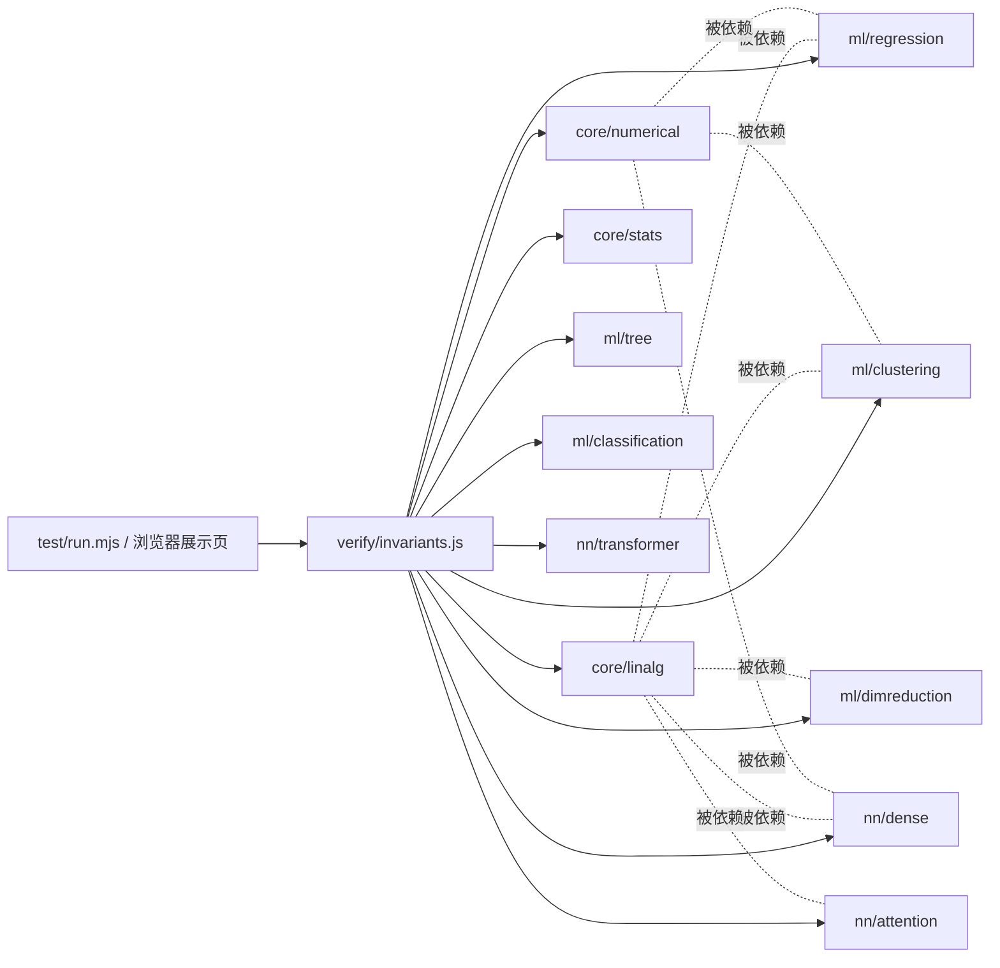

# 旗舰AI引擎 · 架构设计（ARCHITECTURE.md）

> 作者：晨星 (CJX0712) · 零依赖 · 浏览器 + Node 双跑 · 可验证不变量驱动

## 1. 实现方案与选型

| 决策点 | 选择 | 理由（站在谁之上） |
|---|---|---|
| 语言 | 纯 JavaScript ES Module | 浏览器/Node 原生双跑，零构建、零安装 |
| 依赖 | **0 个**（仅 Node 内置） | 数值算法全部手写但严格对齐权威实现 |
| 线性代数 | Jacobi 特征分解 / Householder QR / 部分主元高斯消元 | Golub & Van Loan《Matrix Computations》+ Numerical Recipes |
| 数值稳定 | logsumexp max-shift / 双支 sigmoid | 国际通行的数值稳定写法（scipy 同款思想） |
| EM / GMM | 对数域责任度 + Cholesky 行列式 | Bishop《PRML》第 9 章标准流程 |
| 注意力 | 缩放点积 + 多头 + 手推反向 | 《Attention Is All You Need》(Vaswani 2017) |
| 验证 | 每算法 ≥1 条可交叉验证的不变量 | forge 传统：解析解 vs 数值解、中心差分梯度检验 |

## 2. 文件清单

```
flagship-ai-engine/
├── src/
│   ├── index.js                 # 统一出口（barrel）
│   ├── core/
│   │   ├── linalg.js            # 线性代数：matmul/solve/inverse/cholesky/qr/jacobiEig/svd/powerIteration
│   │   ├── numerical.js         # 数值稳定：logsumexp/softmax/sigmoid/relu
│   │   └── stats.js             # 概率统计：gaussianPDF/entropy/KL/covarianceMatrix/随机源
│   ├── ml/
│   │   ├── regression.js        # 线性回归/岭回归/逻辑回归(+解析梯度)
│   │   ├── classification.js    # kNN / 高斯朴素贝叶斯
│   │   ├── clustering.js        # k-means(++初始化) / GMM(EM)
│   │   ├── dimreduction.js      # PCA(经 Jacobi 特征分解)
│   │   ├── dbscan.js            # DBSCAN 密度聚类（含 ARI 评估）
│   │   ├── tsne.js              # t-SNE 非线性嵌入（困惑度二分 + Student-t）
│   │   ├── svm.js               # RBF 核 SVM（SMO 对偶求解，KKT 自检）
│   │   ├── boosting.js          # AdaBoost（决策树桩加权集成）
│   │   ├── hmm.js               # HMM 前向/后向 + Baum-Welch(EM)
│   │   └── tree.js              # CART 决策树(Gini)
│   ├── nn/
│   │   ├── dense.js             # 全连接网络(前向/反向/梯度检验)
│   │   ├── attention.js         # 缩放点积注意力(前向/反向/梯度检验)/多头
│   │   ├── transformer.js       # LayerNorm/位置编码/Transformer 块
│   │   ├── rnn.js               # Elman RNN + BPTT(梯度检验)
│   │   ├── lstm.js              # LSTM 门控网络 + BPTT(梯度检验)
│   │   └── optimizers.js        # SGD-Momentum / RMSProp / Adam + minimize
│   ├── rl/
│   │   ├── valueIteration.js    # 值迭代/策略评估/网格世界/链式 MDP 暴力枚举
│   │   └── qLearning.js         # Q-learning(免模型TD) + Bellman 残差 + qFromV
│   └── verify/
│       └── invariants.js        # 18 组不变量自检套件（Node 与浏览器共用同一份）
├── test/run.mjs                 # 无头自检入口 → PASS 18/18
├── showcase/
│   ├── template.html            # 旗舰展示页模板（9 个实时演示）
│   └── index.html               # 生成物：单文件、内联引擎、双击即用
├── scripts/
│   ├── serve.mjs                # 零依赖静态服务器（可选）
│   └── bundle.mjs               # 把 src 打包内联进 showcase（并 node --check 语法校验）
├── .github/workflows/ci.yml     # 3 个 Node 版本 × 不变量自检
├── ARCHITECTURE.md / MATH.md / README.md / LICENSE
```

## 3. 数据结构与接口约定（共享知识）

| 约定 | 值 |
|---|---|
| 矩阵 | `number[][]`（行主序） |
| 向量 | `number[]` |
| 误差容差 | `EPS = Number.EPSILON ≈ 2.22e-16`；自检阈值：结构类 `1e-9`，梯度检验 `1e-6` |
| 随机源 | `mulberry32(seed)` 可复现；高斯采样 Box–Muller |
| 协方差 | 样本协方差（`/(n-1)`），PCA/GMM 内部一致 |
| 双跑 | 全模块零副作用、零 DOM 依赖；浏览器打包由 `scripts/bundle.mjs` 注入 `globalThis.FlagshipAI` |

核心签名（节选）：

```js
matmul(A, B) -> number[][]
solve(A, b) -> number[]            // 部分主元高斯消元
cholesky(A) -> L                   // SPD → 下三角
qr(A) -> { Q, R }                  // Householder
jacobiEig(A) -> { values, vectors }// 对称阵，降序
svd(A) -> { U, s, V }              // A = UΣVᵀ（要求行数≥列数）
logsumexp(x) -> number             // 数值稳定
softmax(x) -> number[]
linearRegression(X, y) -> { w, predict }
logisticRegression(X, y, opts) -> { w, losses, ... }
kmeans(X, k, opts) -> { labels, centers, sseHistory }
gmm(X, k, opts) -> { means, covs, weights, resp, llHistory }
pca(X, k) -> { components, explained, proj, reconstruct }
DecisionTree.fit/predict           // CART + Gini
DenseNet.forward/loss/backward     // 反向传播 + 梯度检验
scaledDotProductAttention(Q,K,V) -> { A, O }
multiHeadAttention(Q,K,V,opts)
runAllInvariants() -> { results, passed, total, allOk }
```

## 4. 调用流程（自检驱动）



浏览器路径：`scripts/bundle.mjs` 按依赖序拼接 src → 剥离 import/export → IIFE 注入 `globalThis.FlagshipAI` → 语法校验 → 写入 `showcase/index.html`。Node 路径：`node test/run.mjs` 直接吃 ESM。两路共用同一份 `runAllInvariants()`，杜绝"测试与展示两套逻辑"漂移。

## 5. 有序任务列表

| # | 任务 | 依赖 |
|---|---|---|
| T1 | core/linalg（线性代数地基） | — |
| T2 | core/numerical + core/stats | T1 |
| T3 | ml/regression（含解析梯度，供梯度检验） | T1,T2 |
| T4 | ml/classification + clustering + dimreduction + tree | T1,T2 |
| T5 | nn/dense（反向传播 + 梯度检验） | T1,T2 |
| T6 | nn/attention + transformer | T1,T2,T5 |
| T7 | verify/invariants（18 组套件） | T1–T6 |
| T8 | test/run.mjs 跑通 18/18 | T7 |
| T9 | bundle + showcase 单文件页 | T7 |
| T10 | 文档 + GitHub 推送 + CI 绿 | T8,T9 |

## 6. 待明确事项

无（用户已授予全权自治）。
