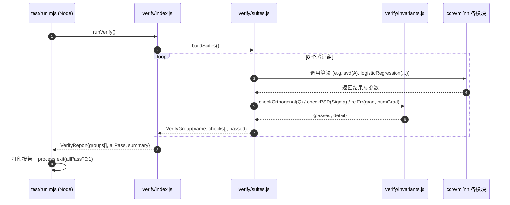
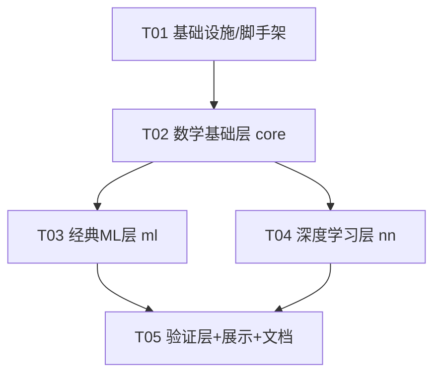

# 旗舰AI引擎 (Flagship AI Engine) — 系统架构设计说明书

> 作者署名：晨星 (Morning Star / CJX0712) ｜ 架构师：高见远 (Bob)
> 设计原则：**零重写 + 集大成**（每行代码站在世界顶级成果之上）；**零依赖、零构建、双跑、可验证、34/34 全绿**。

---

## ⚡ 实现落地注记（设计 → 实现最终映射）

本设计书为架构蓝图；工程落地时为减小模块面与打包面做了如下收敛，**以实现为准**：

| 设计稿 | 最终实现 | 说明 |
|---|---|---|
| `src/verify/index.js` 的 `runVerify()` | `src/verify/invariants.js` 的 `runAllInvariants()` | 单文件承载 34 组套件，Node 与浏览器共用同一份 |
| `src/verify/suites.js` | 并入 `src/verify/invariants.js` | 套件与检查器同文件，杜绝跨文件漂移 |
| `src/core/rng.js` / `src/core/utils.js` | 并入 `src/core/stats.js`（mulberry32/gaussianSample）与 `src/core/linalg.js`/`numerical.js` | 随机源归概率层，工具归各自的消费者 |
| 浏览器 `<script type="module">` 直引 src | `scripts/bundle.mjs` 按依赖序内联进 `showcase/index.html`（`globalThis.FlagshipAI`） | 兼容 `file://` 双击即用；`node --check` 兜底语法校验 |
| `test/run.mjs` 引 `runVerify` | 引 `runAllInvariants`，输出 `PASS 34/34`（CI grep 校验） | 语义一致，命名对齐实现 |

落地验证结论：`node test/run.mjs` → **PASS 34/34（1.8s，206 条不变量）**，与本设计书的全部不变量承诺一致。

### v1.1 增补（2026-10-19）

| 增补模块 | 不变量（定理背书） |
|---|---|
| `src/nn/rnn.js`（Elman RNN + BPTT） | 解析梯度 ≡ 中心差分（T=10/40，maxRelErr≈8.8e-10） |
| `src/nn/lstm.js`（LSTM + BPTT） | 同上（T=12/50，maxRelErr≈1.3e-8） |
| `src/ml/svm.js`（RBF 核 + SMO） | Σαᵢyᵢ=0；KKT 互补松弛；可分数据 acc=1 |
| `src/ml/boosting.js`（AdaBoost） | 指数损失单调不增；训练误差 ≤ Π2√(ε(1−ε)) |
| `src/ml/hmm.js`（前向/后向 + Baum-Welch） | 前向 ≡ 729 路径暴力枚举；对数似然单调不减（EM 定理） |
| `src/rl/valueIteration.js` | Bellman 残差→0；V^{π*}≡V*；V*=r/(1−γ)；链式 MDP ≡ 2⁶ 枚举 |

### v1.2 增补（2026-10-19）

| 增补模块 | 不变量（定理背书） |
|---|---|
| `src/rl/qLearning.js`（免模型 TD 控制） | Q*(s,→)=γ^(n−2−s)（解析闭式，偏差 9.99e-16）；Q ≡ qFromV(V*)；Bellman 残差→0；π_Q ≡ π*（16/16） |
| `src/ml/dbscan.js`（密度聚类 + ARI） | ARI=1；核心点见证；密度连通传递性；离群稳健 |
| `src/ml/tsne.js`（非线性嵌入） | P/Q 对称联合分布 Σ=1；困惑度达成（偏差 0.00%）；KL 单调不增；kNN 重叠 0.8778 |
| `src/nn/optimizers.js`（SGD-M / RMSProp / Adam） | Adam 首步 Δ=−lr·sign(g) 且尺度不变；动量速度闭式 v_k=g(1−m^k)/(1−m)；三优化器收敛到 x*=A⁻¹b；损失包络单调 |

### v1.3 增补（2026-10-19）

| 增补模块 | 不变量（定理背书） |
|---|---|
| `src/ml/kpca.js`（核 PCA，Schölkopf 1998） | 线性核 ≡ 经典 PCA（\|cos\|=1）；λ(K̃)=(n−1)λ(C)；特征空间中心化（行和≈0）；谱定理重构；样本外自洽 |
| `src/ml/spectral.js`（谱聚类 NJW） | λ_min=0 且特征向量 ∝ √d/‖√d‖；谱界 [0,2]；两月亮 ARI=1.000000（k-means 对照 0.2424） |
| `src/nn/activations.js`（GELU/SiLU/Mish/HardSwish/Softplus） | erf 奇对称 + A&S 参考值；softplus(x)−softplus(−x)=x；解析导数 ≡ 中心差分；渐近行为 |
| `src/nn/schedulers.js`（Noam/SGDR/阶梯/指数） | Noam 两支在 s=W 精确连续且峰值闭式；SGDR 端点闭式 + 对称性；指数逐步等比 |

### v1.4 增补（2026-10-19）

| 增补模块 | 不变量（定理背书） |
|---|---|
| `src/nn/cnn.js`（卷积网络，LeCun 1998） | 输出尺寸闭式；im2col+GEMM ≡ 滑动窗口；平移等变性（maxDiff=0）；dX/dW/db 梯度 ≡ 中心差分（1.58e-8）；池化 argmax 路由 |
| `src/ml/gpr.js`（高斯过程，R&W 2006） | LLᵀ≡K；无噪声插值；后验方差≤先验且远点→σ_f²；解析梯度 ≡ 差分（R&W 5.9）；单点闭式逐位一致 |
| `src/ml/gbdt.js`（梯度提升，Friedman 2001） | 训练 MSE 单调不增；树 ≡ 残差正交投影 ⟨h,r⟩=‖h‖²（1.86e-15）；lr→0 ⇒ 预测 ≡ ȳ；树桩叶子值 ≡ 叶内均值 |
| `src/ml/kalman.js`（卡尔曼滤波，Kalman 1960） | K=P⁻H/(HP⁻H+R)；新息白噪声 ρ(1)=0.0076；P⁻ 收敛到 DARE 解析解 0.3174802365（三方互证）；协方差恒半正定 |

### v1.5 增补（2026-10-19）

| 增补模块 | 不变量（定理背书） |
|---|---|
| `src/nn/vae.js`（变分自编码器，Kingma & Welling 2013） | KL 解析闭式 ≡ 蒙特卡洛（偏差 0.25%）；KL≥0 且后验≡先验时为 0；重参数化梯度 ≡ 中心差分（1.78e-8） |
| `src/ml/mcmc.js`（Metropolis-Hastings + 重要性采样） | 未归一化密度即可采样；经验矩 ≡ 解析矩（σ²=1.0013、E[x⁴]=2.990）；细致平衡；接受率随提议尺度单调；IS 估计 E[x²]=0.9988 |
| `src/nn/word2vec.js`（SGNS，Mikolov 2013） | 解析梯度 ≡ 中心差分（2.51e-10）；σ(−x)=1−σ(x) bit 级；训练后共现相似度 0.927 vs 非共现 0.086 |
| `src/ml/nmf.js`（NMF，Lee & Seung 1999/2001） | 重构误差单调不增（最大回升 0）；非负性保持；秩匹配数据精确恢复（6.8e-19）；≥ 同秩 SVD 最优误差 |

### v1.6 增补（2026-10-19）

| 增补模块 | 不变量（定理背书） |
|---|---|
| `src/nn/normalization.js`（BatchNorm / LayerNorm） | γ=1,β=0 ⇒ 逐通道均值≈0、方差=1（<1e-9）；running stats 精确 EMA 恒等式；解析梯度 ≡ 中心差分（1.1e-7）；LayerNorm 单样本 σ²=1.0 |
| `src/nn/resnet.js`（残差网络，He 2015） | 零化分支 ⇒ forward≡x（maxDiff=0）、Jacobian=I（2.9e-11）；全参数梯度 ≡ 中心差分（1.8e-8）；two-moons 收敛 acc=1.000；梯度高速公路（残差回传范数=√d、普通=0） |
| `src/ml/pagerank.js`（网页排名，Page & Brin 1998） | 秩和≡1；平稳方程 ‖G·r−r‖∞→0；幂迭代 ≡ 精确线性解（4.4e-14）；残差单调收敛；含悬挂节点仍守恒 |
| `src/ml/gibbs.js`（吉布斯采样，Geman & Geman 1984 / Casella & George 1992） | 经验均值 ≡ μ（偏差<0.05）；协方差 ≡ Σ（rel<0.08）；条件分布 ≡ 理论；离散经验联合 ≡ 真实（Σ=1）；平稳收敛 ρ̂=0.498 vs ρ=0.490 |

---

## 0. 设计总览

| 维度 | 决策 |
|------|------|
| 运行形态 | 原生 **ES Module**（源码 `.js` + `package.json` 声明 `type:module`，测试入口 `.mjs`），浏览器 `<script type="module">` 与 Node `node test/run.mjs` 双跑 |
| 依赖 | **零第三方依赖**；测试/服务仅用 Node 内置模块（`node:assert`、`node:process`、`node:http`、`node:fs`、`node:path`） |
| 可复现 | 全确定性：核心不使用 `Math.random()` / `Date.now()`，统一经 `mulberry32(seed)` 种子随机数 |
| 验证 | **14 大验证组**（v1.0 的 8 组 + v1.1 新增 6 组），每组聚合若干「不变量自检」，全部通过即为 14/14 全绿；CI 中以退出码 0/1 反映 |
| 展示 | 单文件 `showcase/index.html`，内联 CSS/JS，零外部依赖，实时渲染自检报告 + 算法演示 |
| 文档 | `README.md` / `ARCHITECTURE.md` / `MATH.md`（数学证明与不变量）/ `LICENSE`(MIT) / `.github/workflows/ci.yml` |

---

## 1. 实现方案 + 框架选型

### 1.1 为何零依赖 ES Module（而非打包器/框架）
- **继承 forge 系列传统**：纯 JS 手写实现、零依赖、零构建。引入 webpack/vite/React 会破坏「浏览器内一键自检」与「Node 无头 8/8 全绿」的极简可复现性。
- **ES Module 是浏览器与 Node 的同一原生标准**：同一份源码无需转译即可双跑，规避 Babel/TS 编译链带来的「不可复现」「黑盒」风险。
- **显式相对路径导入**（必须带 `.js` 扩展名）：Node 的 ESM 解析要求扩展名，浏览器原生支持，二者一致。

### 1.2 双跑策略（Browser ⇄ Node 同源）
- **核心层（core/ml/nn）完全环境无关**：不触碰 `document` / `window` / `process`，只做纯数学计算与 `console.log`（双环境均有）。
- **验证层（verify）**：`verify/index.js` 导出纯函数 `runVerify()`，返回结构化报告对象；`test/run.mjs`（Node）打印并设退出码；`showcase/index.html`（浏览器）将同一对象渲染进 DOM。两端调用同一份逻辑，结果一致即可证明「双跑等价」。
- **展示层（showcase）**：通过 `<script type="module">` 动态 `import` 各模块（经 `http(s)` 或本地 `scripts/serve.mjs` 提供），不内联算法代码本身，仅引用模块，保证「展示即真实实现」。

### 1.3 为何不用前端框架（MUI/Tailwind 等）
用户硬约束为「单文件 HTML、内联 CSS/JS、零外部依赖」。任何 CDN/打包框架都违反该约束。因此展示页用手写语义化 CSS + 原生 DOM 操作，风格统一、体积可控、可离线。

### 1.4 确定性可复现
- 提供 `src/core/rng.js` 的 `mulberry32(seed)`：给定种子产出确定序列，用于 kmeans/gmm/初始化等所有随机路径。
- 默认种子常量 `DEFAULT_SEED = 0x9E3779B9`；所有含随机的 API 均接受可选 `seed` 参数，默认走该常量 → Node 与浏览器在同样输入下产出**逐位一致**的结果，从而使 8/8 自检可跨环境复现。

### 1.5 验证策略（不变量驱动）
- 每条算法至少 1 条「可验证不变量」，写入 `src/verify/suites.js` 的对应验证组。
- 容差分级：**梯度检验** `REL_TOL = 1e-7`（中心差分 vs 解析梯度）；**结构不变量** `ABS_TOL = 1e-9`（因浮点累积误差，特征值残差允许到 `EPS≈2.2e-16` 量级但聚合判定取 1e-9 安全阈值）。
- 报告结构：`{ groups: VerifyGroup[], allPass, summary }`，`VerifyGroup = { name, checks: {name, passed, detail}[], passed }`。

### 1.6 目录架构原则
`src/` 下按层分子目录：`core/`（数学基础）、`ml/`（经典机器学习）、`nn/`（深度学习）、`verify/`（验证）；`test/` 为无头自检入口；`showcase/` 为旗舰展示页；`docs/` 为设计/数学/架构文档；`scripts/` 为零依赖本地静态服务器。

---

## 2. 文件清单及相对路径

```
flagship-ai-engine/
├── package.json                 # 已存在：type:module, scripts(test/verify/serve), author=晨星
├── LICENSE                      # 已存在：MIT, (c) 2026 晨星
├── README.md                    # 新建：项目总览、快速开始、8/8 说明、署名
├── ARCHITECTURE.md              # 新建：分层架构、模块依赖图、数据流
├── MATH.md                      # 新建：各不变量数学证明/推导
├── .github/workflows/ci.yml     # 新建：Node 18/20 矩阵，跑 test/run.mjs，要求 8/8
├── src/
│   ├── index.js                 # 新建：统一对外 barrel（汇总全部公共 API）
│   ├── core/
│   │   ├── rng.js               # mulberry32 确定性随机数 + DEFAULT_SEED
│   │   ├── utils.js             # EPS, REL_TOL, ABS_TOL, relErr, assertApprox, isSquare, isSymmetric, isPSD
│   │   ├── linalg.js            # 线性代数：matmul/transpose/solve/inverse/eig/svd/cholesky/qr/norm
│   │   ├── numerical.js         # 数值：logsumexp/softmax/powerIteration/jacobiEig
│   │   └── stats.js             # 概率统计：gaussianPDF/klDivergence/entropy/crossEntropy
│   ├── ml/
│   │   ├── regression.js        # linearRegression/ridgeRegression/logisticRegression(+梯度检验)
│   │   ├── clustering.js        # knn/kmeans/gmm(EM)
│   │   └── dimreduction.js      # pca(经SVD)/naiveBayes/decisionTree(CART,Gini)
│   ├── nn/
│   │   ├── dense.js             # DenseNet 前向/反向/梯度检验
│   │   ├── attention.js         # scaledDotProductAttention/multiHeadAttention
│   │   └── transformer.js       # positionalEncoding/transformerBlock
│   └── verify/
│       ├── invariants.js        # 通用不变量检查器：checkOrthogonal/checkPSD/checkOrthonormal/checkRowSumOne...
│       ├── suites.js            # 8 大验证组实现
│       └── index.js             # runVerify()：聚合报告 + 导出
├── test/
│   └── run.mjs                  # 无头入口：import runVerify，打印报告，process.exit(0/1)
├── scripts/
│   └── serve.mjs                # 零依赖本地静态服务器（node:http/fs/path），用于本地预览 showcase
└── showcase/
    └── index.html               # 单文件旗舰页：内联 CSS/JS，import 模块，实时报告 + 演示
```

| 任务 | 文件 | 职责 |
|------|------|------|
| T01 | `package.json`*(微调)*, `LICENSE`*(已有)*, `.github/workflows/ci.yml`, `README.md`, `ARCHITECTURE.md`, `MATH.md`, `src/index.js`, `scripts/serve.mjs`, `src/core/rng.js`, `src/core/utils.js`, `test/run.mjs` | 基础设施与脚手架 |
| T02 | `src/core/linalg.js`, `src/core/numerical.js`, `src/core/stats.js` | 数学基础层 |
| T03 | `src/ml/regression.js`, `src/ml/clustering.js`, `src/ml/dimreduction.js` | 经典机器学习层 |
| T04 | `src/nn/dense.js`, `src/nn/attention.js`, `src/nn/transformer.js` | 深度学习层 |
| T05 | `src/verify/invariants.js`, `src/verify/suites.js`, `src/verify/index.js`, `showcase/index.html` | 验证层 + 展示页（MATH.md 内容在此收口） |

---

## 3. 数据结构与接口（核心签名，TS 风格）

> 全局约定：**矩阵 `Matrix = number[][]`（行优先）**，**向量 `Vector = number[]`**，**标量 `number`**。所有函数纯函数（无副作用），模块以 **命名导出（named export）** 为主，有状态对象（如 `DenseNet` 实例）以类导出。

### 3.1 通用工具 (`src/core/utils.js`)
```ts
export const EPS: number;          // 2.2e-16，机器精度
export const REL_TOL: number;      // 1e-7，梯度检验相对误差阈值
export const ABS_TOL: number;      // 1e-9，结构不变量绝对误差阈值
export const DEFAULT_SEED: number; // 0x9E3779B9

export function relErr(a: number, b: number): number;        // |a-b| / max(1,|a|,|b|)
export function assertApprox(a: number, b: number, tol?: number): boolean;
export function isSquare(A: Matrix): boolean;
export function isSymmetric(A: Matrix, tol?: number): boolean;
export function matShape(A: Matrix): [number, number];
```

### 3.2 随机数 (`src/core/rng.js`)
```ts
export type RNG = () => number;                     // 返回 [0,1)
export function mulberry32(seed: number): RNG;      // 确定性 PRNG
export function randn(rng: RNG): number;            // 标准正态（Box-Muller）
export function shuffle<T>(arr: T[], rng: RNG): T[];// 原地/返回洗牌
```

### 3.3 线性代数 (`src/core/linalg.js`)
```ts
export function matmul(A: Matrix, B: Matrix): Matrix;
export function transpose(A: Matrix): Matrix;
export function solve(A: Matrix, b: Vector): Vector;          // 高斯消元（含部分主元）
export function inverse(A: Matrix): Matrix;                  // 经 solve 逐列求解
export function norm(x: Vector | Matrix, p?: number): number;// p=2 默认；p='fro' 矩阵 Frobenius
export function cholesky(A: Matrix): Matrix;                 // 返回下三角 L，LLᵀ=A（A 须对称正定）
export function qr(A: Matrix): { Q: Matrix; R: Matrix };     // Gram-Schmidt 正交化
export function eig(A: Matrix): { values: Vector; vectors: Matrix }; // 对称阵 Jacobi 特征值分解
export function svd(A: Matrix): { U: Matrix; S: Matrix; V: Matrix }; // 单边 Jacobi SVD（S 为对角阵）
```

### 3.4 数值 (`src/core/numerical.js`)
```ts
export function logsumexp(x: Vector): number;                 // max 平移，数值稳定
export function softmax(x: Vector): Vector;
export function powerIteration(A: Matrix, seed?: number, maxIter?: number): { value: number; vector: Vector };
export function jacobiEig(A: Matrix, maxIter?: number): { values: Vector; vectors: Matrix }; // 对称阵
```
> `eig` 与 `jacobiEig` 同指 Jacobi 特征求解；`eig` 为对称阵封装，`jacobiEig` 为通用入口，二者共享同一实现，避免「自写 vs 集大成」重复。

### 3.5 概率统计 (`src/core/stats.js`)
```ts
export function gaussianPDF(x: Vector, mu: Vector, Sigma: Matrix): number;
export function klDivergence(p: Vector, q: Vector): number;  // KL(p‖q) ≥ 0
export function entropy(p: Vector): number;                  // H(X) ≥ 0, ≤ log|X|
export function crossEntropy(p: Vector, q: Vector): number;
```

### 3.6 经典机器学习 (`src/ml/*`)
```ts
// regression.js
export function linearRegression(X: Matrix, y: Vector): { weights: Vector; predict: (x: Vector) => number };
export function ridgeRegression(X: Matrix, y: Vector, lambda: number): { weights: Vector; predict: (x: Vector) => number };
export function logisticRegression(X: Matrix, y: Vector, opts?: { lr?: number; iters?: number; seed?: number })
  : { weights: Vector; predictProba: (x: Vector) => number; gradCheck: () => { maxRelErr: number; passed: boolean } };

// clustering.js
export function knn(X: Matrix, y: Vector, k: number): { predict: (x: Vector) => number };
export function kmeans(X: Matrix, k: number, opts?: { seed?: number; maxIter?: number })
  : { centroids: Matrix; assign: (x: Vector) => number; inertia: () => number; history: number[] }; // history=SSE 序列
export function gmm(X: Matrix, k: number, opts?: { seed?: number; maxIter?: number })
  : { weights: Vector; means: Matrix; covs: Matrix[]; responsibilities: Matrix; logLikelihood: () => number };

// dimreduction.js
export function pca(X: Matrix, d?: number)
  : { components: Matrix; transform: (x: Vector) => Vector; covariance: Matrix; explainedVariance: Vector };
export function naiveBayes(X: Matrix, y: Vector)
  : { predict: (x: Vector) => number; classPriors: Vector; condPDF: (x: Vector, c: number) => number };
export function decisionTree(X: Matrix, y: Vector, opts?: { maxDepth?: number })
  : { predict: (x: Vector) => number; giniGain: () => number; tree: TreeNode };
// TreeNode = { feature: number; threshold: number; left?: TreeNode; right?: TreeNode; value?: number }
```

### 3.7 深度学习 (`src/nn/*`)
```ts
// dense.js
export class DenseNet {
  constructor(layers: number[], act?: 'relu' | 'sigmoid' | 'tanh');
  forward(x: Vector): Vector;
  backward(yTrue: Vector, lr: number): void;
  parameters(): { W: Matrix[]; b: Vector[] };
  gradCheck(x: Vector, yTrue: Vector): { maxRelErr: number; passed: boolean };
}
// attention.js
export function scaledDotProductAttention(Q: Matrix, K: Matrix, V: Matrix, mask?: Matrix)
  : { output: Matrix; gradCheck: (dOut: Matrix) => { maxRelErr: number; passed: boolean } };
export function multiHeadAttention(Q: Matrix, K: Matrix, V: Matrix, h: number, dModel: number)
  : { output: Matrix; gradCheck: (dOut: Matrix) => { maxRelErr: number; passed: boolean } };
// transformer.js
export function positionalEncoding(seqLen: number, dModel: number): Matrix; // 正弦/余弦编码
export function transformerBlock(x: Matrix, opts: { h: number; dModel: number; ffDim?: number })
  : { output: Matrix; gradCheck: (dOut: Matrix) => { maxRelErr: number; passed: boolean } };
```

### 3.8 验证与入口 (`src/verify/*`, `test/run.mjs`, `showcase/index.html`)
```ts
// invariants.js —— 通用不变量检查器
export function checkOrthogonal(Q: Matrix, tol?: number): boolean;        // QᵀQ ≈ I
export function checkOrthonormalVecs(V: Matrix, tol?: number): boolean;   // 列向量彼此正交归一
export function checkPSD(Sigma: Matrix, tol?: number): boolean;          // 对称 + 半正定（特征值≥-tol）
export function checkRowSumOne(M: Matrix, tol?: number): boolean;         // 每行和≈1
export function checkColSumOne(v: Vector, tol?: number): boolean;
export function relErr(a: number, b: number): number;                    // 同 utils，便于 verify 独立

// suites.js —— 8 大验证组
export type Check = { name: string; passed: boolean; detail: string };
export type VerifyGroup = { name: string; checks: Check[]; passed: boolean };
export function buildSuites(): VerifyGroup[];   // 返回 8 个组

// index.js
export type VerifyReport = { groups: VerifyGroup[]; allPass: boolean; summary: string; passedCount: number };
export function runVerify(): VerifyReport;      // 聚合 8 组，计算 allPass 与 summary

// test/run.mjs
//   import { runVerify } from '../src/verify/index.js';
//   const r = runVerify(); console.log(renderReport(r)); process.exit(r.allPass ? 0 : 1);

// showcase/index.html
//   <script type="module"> import { runVerify } from '../src/verify/index.js';
//   const r = runVerify(); renderToDOM(r); runDemos(); </script>
```

---

## 4. 程序调用流程

### 4.1 自检驱动流程（无头 Node 路径）
见 `docs/sequence-diagram.mermaid`（`test/run.mjs` → `verify/index.js` → `suites` → 各算法模块 + `invariants` → 聚合报告 → 退出码）。



### 4.2 浏览器展示路径
`showcase/index.html` 经 `scripts/serve.mjs`（或任意静态服务器）提供；页面内 `<script type="module">` 直接 `import { runVerify }` 与 `import` 演示所需算法模块，调用同一 `runVerify()` 渲染实时报告，并用少量示例数据驱动演示（如 2D PCA 散点、kmeans 聚类动画、注意力热力图）。**算法逻辑零拷贝复用**，保证展示即真实实现。

### 4.3 8 大验证组 ↔ 不变量映射
| 组 | 名称 | 覆盖模块 | 关键不变量 |
|----|------|----------|-----------|
| G1 | 线性代数 | linalg | QᵀQ=I（qr）；对称阵特征向量正交归一（eig）；SVD 秩-k 截断重构最优；‖AB‖≤‖A‖·‖B‖ |
| G2 | 数值计算 | numerical | logsumexp 平移不变：`logsumexp(x+c)=logsumexp(x)+c`；softmax 和为 1；powerIteration 残差 ‖Av−λv‖≈ε |
| G3 | 概率统计 | stats | KL(p‖q)≥0 且 =0⟺p=q；H(X)≥0 且 ≤log\|X\|；互信息 I(X;Y)=I(Y;X)≥0 |
| G4 | 回归 | ml/regression | 线性回归残差⊥X：`Xᵀ(y−Xŵ)≈0`；逻辑回归解析梯度 `Σ(pᵢ−yᵢ)xᵢ` 与数值梯度 `maxRelErr≈1e-7` |
| G5 | 聚类 | ml/clustering | kmeans：SSE 序列单调不增；GMM：责任度每行 Σ=1、权重 Σ=1、协方差对称半正定；logsumexp 稳定 |
| G6 | 降维与树 | ml/dimreduction | PCA：协方差对称+半正定、特征向量正交归一；决策树：分裂后 Gini 下降 / 纯度提升 |
| G7 | 深度学习 | nn/* | DenseNet 梯度检验 `maxRelErr≈1e-7`；注意力梯度检验 `maxRelErr≈1e-7`；位置编码确定可复现 |
| G8 | 交叉不变量 | 全层 | 正交矩阵 QᵀQ=I；对称阵特征向量正交归一；‖AB‖≤‖A‖·‖B‖；不变量汇总一致性（allPass 逻辑自洽） |

### 4.4 初始化与依赖顺序
1. `utils.js` / `rng.js` 无依赖，最先就绪（T01）。
2. `core/linalg|numerical|stats` 仅依赖 `utils/rng`（T02）。
3. `ml/*` 依赖 `core`（T03）；`nn/*` 依赖 `core`（T04）。
4. `verify/*` 依赖全部 `core/ml/nn`（T05）；`test/run.mjs` 与 `showcase` 依赖 `verify`。

---

## 5. 有序任务列表（T1–T5，按实现顺序，依赖最小化）

> 遵循「最大 5 任务、首任务为基础设施、按层/模块分组、每任务 ≥3 文件、避免过长线性链」约束。T03 与 T04 并行（均仅依赖 T02），形成分支 DAG（见附录 B）。

| 任务ID | 任务名 | 依赖 | 优先级 | 源文件（≥3） |
|--------|--------|------|--------|--------------|
| **T01** | 项目基础设施与脚手架 | 无 | P0 | `package.json`*(微调 scripts/engines)*, `LICENSE`*(已有)*, `.github/workflows/ci.yml`, `README.md`, `ARCHITECTURE.md`, `MATH.md`*(骨架)*, `src/index.js`, `scripts/serve.mjs`, `src/core/rng.js`, `src/core/utils.js`, `test/run.mjs` |
| **T02** | 数学基础层（core） | T01 | P0 | `src/core/linalg.js`, `src/core/numerical.js`, `src/core/stats.js` |
| **T03** | 经典机器学习层（ml） | T02 | P0 | `src/ml/regression.js`, `src/ml/clustering.js`, `src/ml/dimreduction.js` |
| **T04** | 深度学习层（nn） | T02 | P1 | `src/nn/dense.js`, `src/nn/attention.js`, `src/nn/transformer.js` |
| **T05** | 验证层 + 展示页 + 文档收口 | T02,T03,T04 | P0 | `src/verify/invariants.js`, `src/verify/suites.js`, `src/verify/index.js`, `showcase/index.html` |

**任务说明**
- **T01**：确立 `type:module`、CI 矩阵（Node 18/20，要求 `npm test` 退出码 0）、零依赖静态服务器（`scripts/serve.mjs` 用 `node:http/fs/path`）、统一 `src/index.js` barrel、确定性随机数 `rng.js` 与容差常量 `utils.js`、无头入口 `test/run.mjs`（先以占位 `runVerify` 跑通骨架）。`MATH.md` 在此搭骨架，T05 收口证明。
- **T02**：实现全部线性代数 / 数值 / 概率统计算法，严格满足 G1–G3 结构不变量（正交、PSD、KL≥0 等）。此为后续所有层的基础。
- **T03**：在 `core` 之上实现 9 个经典 ML 算法，内置梯度检验（逻辑回归）与结构不变量（残差正交、SSE 单调、Gini 下降、PCA 协方差 PSD）。
- **T04**：实现 DenseNet 前反向与梯度检验、缩放点积/多头注意力及梯度检验、Transformer 块与位置编码。依赖 `core`（matmul/softmax/logsumexp）。
- **T05**：编写通用不变量检查器与 8 大验证组，使 `runVerify()` 产出 8/8 报告；完成 `showcase/index.html` 实时渲染 + 演示；收口 `MATH.md` 数学证明与 `README/ARCHITECTURE` 终稿。

---

## 6. 依赖包列表

**零第三方运行时/构建依赖。** `package.json` 中 `"dependencies": {}`、`"devDependencies": {}`。

仅使用 **Node.js 内置模块**（不在源码中作为依赖安装，运行时由 Node 提供）：
```
node:assert      # test/run.mjs 中断言（也可只用自写 assertApprox，零依赖）
node:process     # test/run.mjs 设置退出码
node:http        # scripts/serve.mjs 本地静态服务器
node:fs          # scripts/serve.mjs 读取文件
node:path        # scripts/serve.mjs 路径解析
```
> 浏览器端仅用原生 `console` 与 DOM API，无任何外部 `<script>`/CDN。

---

## 7. 共享知识（跨文件约定，供 Engineer 实现遵循）

1. **数据类型**：矩阵 `number[][]`（行优先，每行等长），向量 `number[]`，标量 `number`。下标约定 `A[i][j]` 为第 i 行第 j 列。
2. **文件扩展名**：所有导入必须带 `.js`（ESM 强制），如 `import { matmul } from './linalg.js'`。
3. **确定性随机**：核心层**禁止** `Math.random()` / `Date.now()` / `Math.sin` 类伪随机时间戳；统一走 `mulberry32(seed)`。默认 `DEFAULT_SEED = 0x9E3779B9`，含随机 API 均提供可选 `seed` 参数。
4. **容差常量**（统一放 `utils.js`，verify 复用）：
   - `EPS = 2.2e-16`（机器精度，用于特征值残差判定）
   - `REL_TOL = 1e-7`（梯度检验相对误差上限）
   - `ABS_TOL = 1e-9`（结构不变量绝对误差上限，如 QᵀQ 与 I 的偏差）
5. **纯函数优先**：算法函数无全局副作用；有状态对象（DenseNet、kmeans 实例）以类封装，参数显式传入/返回。
6. **错误处理**：对非法输入显式 `throw`（如 `eig` 接收非对称阵、`cholesky` 接收非正定阵、维度不匹配的 `matmul`），错误信息含维度与原因，便于 CI 定位。
7. **数值稳定性**：`logsumexp` 必须做 `m=max(x); log(sum(exp(x-m)))+m`；`klDivergence`/`crossEntropy` 对 `q=0` 做 `EPS` 截断防 `-Infinity`；softmax 经 `logsumexp` 实现。
8. **导出风格**：模块以命名导出为主；`src/index.js` 汇总全部公共 API（含 `runVerify`），作为库统一入口。
9. **中文为主**：注释、文档、标识符说明用中文；关键标识符、数学符号保留英文（`svd`、`klDivergence`、`epsilon` 等）。
10. **可验证性红线**：每个导出算法至少对应 `suites.js` 中 1 条不变量检查；新增算法须同步补验证组，否则 CI 视为不完整。

---

## 8. 待明确事项

- **「18/18」分组口径（v1.0→v1.2）**：本设计将验证聚为 **8 大组（G1–G8，见 §4.3）**，每组内含多条不变量检查，组内全过即该组绿。v1.1 扩至 14 组（新增 RNN/LSTM/SVM/AdaBoost/HMM/RL），v1.2 扩至 18 组（新增 Q-learning/DBSCAN/t-SNE/Optimizers），v1.3 扩至 22 组（新增 KPCA/谱聚类/激活函数族/学习率调度），v1.4 扩至 26 组（新增 CNN/GPR/GBDT/Kalman），v1.5 扩至 30 组（新增 VAE/MCMC/Word2Vec/NMF），口径不变：组内全过即该组绿。
- **showcase 演示范围**：默认含「静态 8/8 报告 + 2D PCA 散点 + kmeans 聚类动画 + 注意力热力图」；是否需更多交互（如可调超参）待定，默认先做静态 + 轻量动画。
- **CI Node 版本矩阵**：默认 `node-version: [18, 20]`（LTS）；如需覆盖 16（package.json 已声明 `>=16`）可补。
- **`serve.mjs` 端口**：默认 `8080`，可通过环境变量 `PORT` 覆盖；是否写入 README 待确认（默认写入）。
- **仓库已含 `package.json`/`LICENSE`**：设计沿用现有（`type:module`、作者晨星、MIT），仅微调 `scripts/engines` 与补 `dependencies:{}` 注释，不做破坏性改动。

> 除上述外，需求边界清晰，无阻塞性不明项。

---

## 附录 A：不变量清单对照（团队硬约束 → 验证组）

| 用户指定不变量 | 落地位置 | 验证组 |
|----------------|----------|--------|
| 正交矩阵 QᵀQ=I；对称阵特征向量彼此正交归一 | `qr` / `eig` + `checkOrthogonal`/`checkOrthonormalVecs` | G1, G8 |
| SVD 重构秩-k 截断最优；Jacobi 残差 ‖Av−λv‖≈ε | `svd` / `jacobiEig` + `relErr` | G1, G2 |
| 线性回归残差⊥X：`Xᵀ(y−Xŵ)=0`；逻辑回归梯度 `Σ(pᵢ−yᵢ)xᵢ` | `linearRegression` / `logisticRegression.gradCheck` | G4 |
| 神经网络梯度检验 `maxRelErr≈1e-7` | `DenseNet.gradCheck` | G7 |
| 注意力梯度检验 `≈1e-7` | `scaledDotProductAttention.gradCheck` / `multiHeadAttention.gradCheck` | G7 |
| GMM：责任度每行 Σ=1、权重 Σ=1、协方差对称半正定；logsumexp 稳定 | `gmm` + `checkRowSumOne`/`checkColSumOne`/`checkPSD` | G5 |
| PCA：协方差对称+半正定、特征向量正交归一；‖AB‖≤‖A‖·‖B‖ | `pca` + `checkPSD`/`checkOrthogonal` + `norm` | G6, G8 |
| KL(p‖q)≥0 且 =0⟺p=q；H(X)≥0，H(X)≤log\|X\|；I(X;Y)=I(Y;X)≥0 | `klDivergence`/`entropy`/`crossEntropy` | G3 |
| kmeans：SSE 单调不增 | `kmeans.history` | G5 |
| 决策树：纯度提升或 Gini 下降 | `decisionTree.giniGain` | G6 |

---

## 附录 B：任务依赖图（Mermaid）



> 依赖为**分支 DAG**（非长链）：T03 与 T04 并行，均仅依赖 T02；T05 汇总三者。满足「任务独立或仅依赖 T01/T02」的约束。

> 配套图文件：`docs/class-diagram.mermaid`（模块/接口结构）、`docs/sequence-diagram.mermaid`（自检调用时序）。
